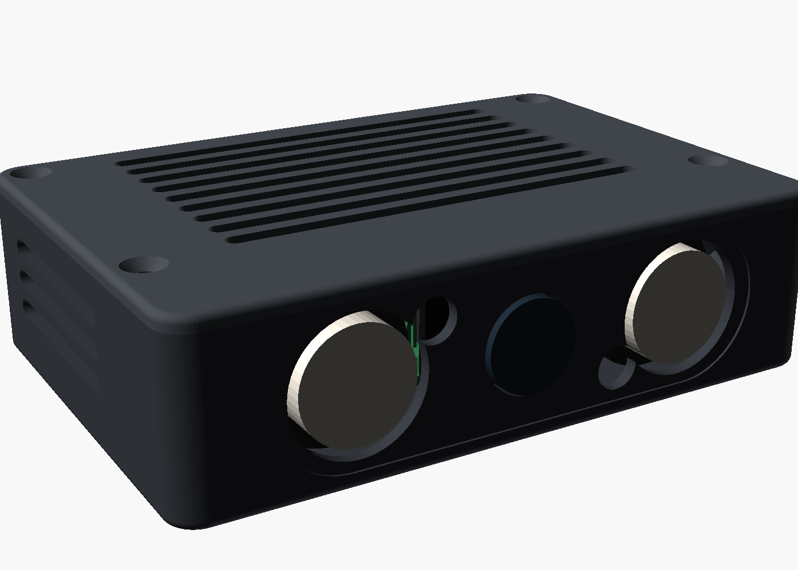
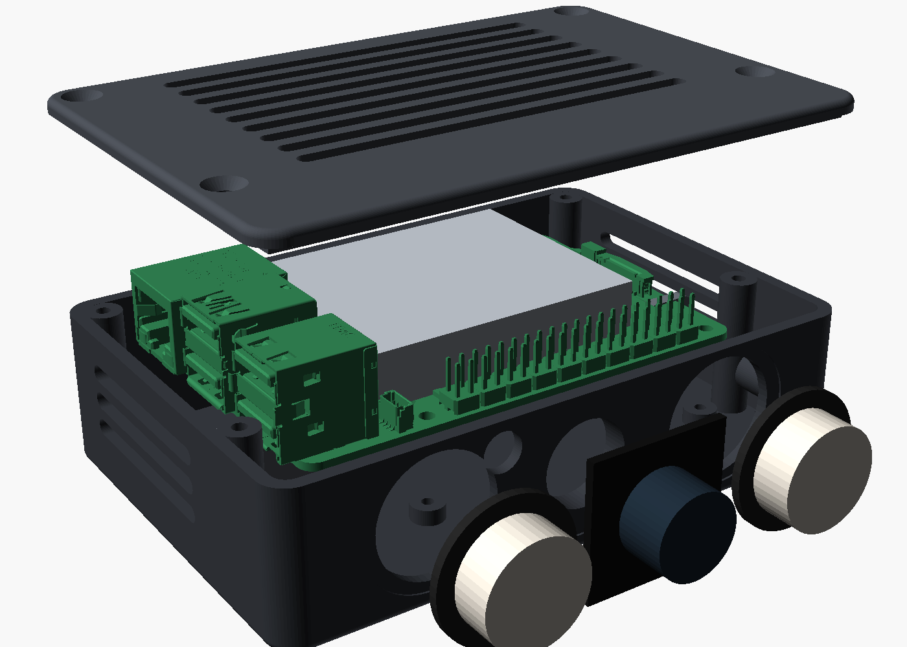
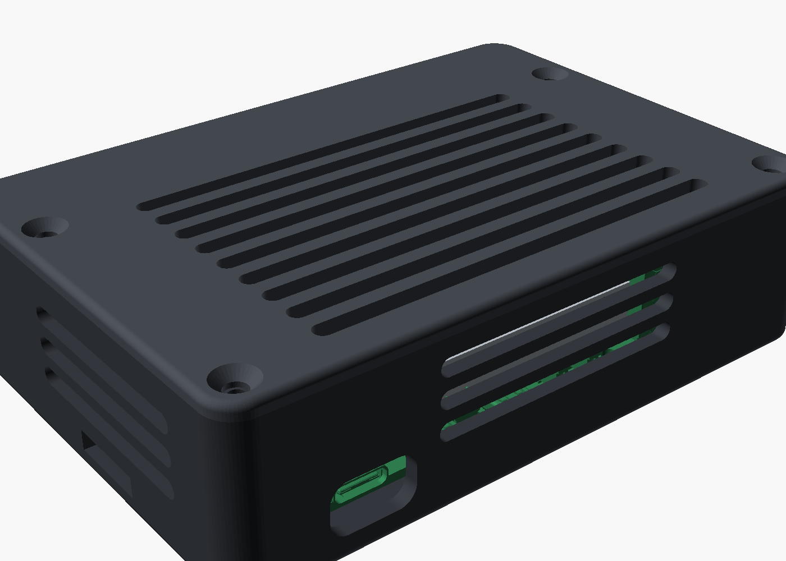

# Enclosure: 3D-printed case for the Pi 5 + IR camera

↑ [[Home]] | Device: [[Raspberry Pi 5 Target]] | Open items: [[Open Items and Next Steps]] | Log: [[Project Log 2026-11]]

One printed box that holds the **Raspberry Pi 5 with its Active Cooler** and the **IR night-vision
camera with its two IR boards**. It is the physical unit for [[5.2 Phase Two Plan]] step 1
(hardware assembly). There is no AI HAT in it; the team doesn't have one (see [[Pi Setup Plan]]).

> [!abstract] State at 21 Nov 2026
> **Designed (concept B, "Brick"), printable files ready, nothing printed yet.**
> 108.8 × 85 × 30 mm. CadQuery model + STEP + STL in `hardware/enclosure/brick/`.
> Checked against a real Pi 5 model: **0 mm³ clash**, holes and USB-C line up.
> **Not verified:** the camera fit on the real board, the Active Cooler (not in the reference
> model), and anything printed.

## Requirements (from the team)

- Holds the Pi 5 + Active Cooler and the IR camera with both IR boards. **No AI HAT.**
- Openings **only for power and air**: USB-C in, fan intake, exhaust vents. (A microSD slot is in the model as an
  option, off: the team only cares about the USB-C opening.)
- Placement in the car is **deliberately set aside** for now; the shape was chosen first.
- **Printed in PLA** (team decision, see [[#Material]]).
- Screws easy to buy: **one size, M2.5**.

## How the design was chosen

1. **First draft, concept A "Slab"** (OpenSCAD, `hardware/enclosure/rtdms_enclosure.scad`): Pi
   standing upright behind the camera, fan facing a back grille, 106 × 72 × 39 mm. Built from
   guessed camera sizes, because the Raspberry Pi and Waveshare datasheet sites are blocked from the
   agent's environment. Kept in the repo as the concept-A reference.
2. **Concept board**: four shapes drawn side by side, each with front/back views and an airflow
   cut-away: A Slab, B Brick, C Wedge (front tilted 15°), D Pod + Base (hinged camera pod).
   Published as a private artifact: <https://claude.ai/artifact/QPMfHnKFBHkxLPCCmt7u2e>.
3. **The team picked B, the Brick**: Pi lying flat, fan up through a top grille, camera on the front
   wall, power out the back.
4. **Reference models** supplied by the team replaced the guesses (see [[#Reference models]]).
5. **Built in CadQuery.** Chosen because the agent can write, run and verify it end to end, and it
   exports **STEP**, so the team can open the design in Fusion 360 / Onshape. OpenSCAD can't export
   STEP, and Blender has no real dimensions or constraints (fine for presentation renders only).

| Concept | Size (W × H × D) | Why not / why |
|---|---|---|
| A Slab | 106 × 72 × 39 | Thinnest, but tallest face and cable out the top |
| **B Brick** | **108.8 × 30 × 85** (as built) | **Chosen.** Lowest, sits flat, power out the back |
| C Wedge | 100 × 54 × 82 | Camera aimed up, but tilt fixed and harder to print |
| D Pod + Base | 100 × 77 × 70 | Adjustable tilt, but hinge + ribbon wear, more parts |

## The design (Brick)

- **Pi:** lies flat on 4 standoffs, board underside 5.2 mm above the box bottom (same as
  OpenPiCase). Rotated so the **USB-C/HDMI edge faces the back** and the USB/Ethernet end is on the
  left. The GPIO header runs along the front, behind the camera.
- **Fan:** slotted grille in the lid right over the Active Cooler. The lid sits 4.7 mm above the
  tallest part (the USB stack). Exhaust through slots in both side walls and the back.
- **Power:** USB-C hole in the back wall, sized for an overmoulded plug (14 × 8.5 mm).
- **Camera ribbon (open risk).** The Pi's camera connectors are on the **back edge** (USB-C / HDMI edge)
  and the camera is at the **front**, so the ribbon has to run back over the board and turn 180° into
  the connector. The first 75 mm box left only about 0.4 mm behind the Pi. The box is now **85 mm
  deep**: the extra 10 mm sits behind the Pi for the turn, plus one extra lid post (x = 12 mm) to keep
  the longer lid stiff. The team's ribbon is long (photo, 22 Nov), so reach is not the problem; the
  turn is. I could not pick the camera connector out of the reference Pi model, so the route is
  **not modelled or verified**.
- **microSD:** no opening (option `SD_SLOT`, off). Change the card with the lid open.
- **USB-C hole confirmed** against the Pi model: port centre 32.8 mm = hole centre 32.8 mm; hole 14 × 8.5 mm around an 8.9 × 4.0 mm port.
- **Camera:** front wall with a Ø15.4 lens hole + Ø17 lens collar, two Ø21.4 IR openings at ±27.5 mm,
  and two Ø7 notches for the IR boards' light sensors, so the IR lights still switch on in the dark.
  A shallow stadium-shaped "eye" recess frames them.
- **Camera clamp, no screws into the camera.** As in the original camera mount, two identical
  printed clips press on the back of the IR boards and push the camera against the front wall. The
  camera's own hole spacing (which we couldn't measure) doesn't matter. The pads are **0.5 mm too
  long on purpose**, so each clip bends and keeps pressing like a spring. Foam tape is the fallback
  if it rattles.
- **Lid:** 5 countersunk screws into posts (4 corners + 1 behind the Pi). Kept on screws rather than snap clips because
  **PLA snap clips crack** after a few openings.

### Parts and hardware

| Part | Qty | File |
|---|---|---|
| Shell | 1 | `out/shell.stl` / `.step` |
| Lid | 1 | `out/lid.stl` / `.step` |
| Camera clip | 2 (same part both sides) | `out/camera_clip.stl` / `.step` |
| **M2.5 × 6 mm screws** (5–8 mm fine) | 11 | 4 Pi, 2 clips, 5 lid. Self-tapping into printed holes, no nuts or inserts |

## Reference models

Stored in `hardware/enclosure/ref/` with origin and license in `ref/SOURCES.md`.

| Model | What it gave us |
|---|---|
| **OpenPiCase** (MIT, github.com/marceloeatworld/OpenPiCase @ `7df3ef4`) | Its STEP assembly contains a **detailed Pi 5 board model** (solids 1–591): board 85 × 56 × 1.5, holes on the 58 × 49 grid, USB stack **16.2 mm** tall, Ethernet 13.5 mm. Their case itself is sized for an AI HAT and a Camera Module 3 pod, so we reused numbers, not the shell |
| **Night-vision camera mount** (Bravehartk2, Printables; uploaded by the team) | Made for **our camera type**. Lens Ø15, IR openings Ø21 at ±27.5 mm, light-sensor notches, and **7.0 mm** from the inside of the front face to the back of the IR boards (from stacking `head_front` + `head_back`) |

> [!warning] The Pi model is the case designer's, not Raspberry Pi's official CAD
> It matches the official footprint numbers we know. The **Active Cooler is not in it**, despite
> OpenPiCase's README. If someone downloads the official Pi 5 STEP from raspberrypi.com, re-run the
> clash check against it (blocked from the agent's network).

## Verification

| Check | Result | Status |
|---|---|---|
| Clash with the real Pi 5 model (exact solid intersection) | First run found the **USB stack overhangs 0.9 mm more than spec** and grazed a lid post → interior widened 2 mm, posts moved. Now **0 mm³** (the only contact is the 4 standoff pads) | **verified in CAD** |
| Pi holes ↔ standoffs, USB-C ↔ back hole | Line up with the model | **verified in CAD** |
| Parts are valid closed solids | CadQuery `isValid`, STLs watertight (two tangent post/wall edges fixed) | **verified** |
| Camera fit (clamp depth, opening sizes) on the real board | From the mount model only | **not verified**: needs a test print |
| Camera ribbon route into the Pi connector | Not modelled; 10 mm turning space added | **not verified**: check on the test print |
| Active Cooler clearance | Not in any model; 4.7 mm headroom over the USB stack | **not verified** |
| Printed, assembled, heat in a car | Nothing printed | **not done** |

## Material

Team decision: **PLA**. Its limits and how to live with them:

- PLA softens at about **55–60 °C**. A parked car in an Egyptian summer reaches 60–70 °C inside and
  70–90 °C on sunlit surfaces. **Don't leave the unit in a parked car in the sun**; use a sunshade or
  take it out. Driving with the AC on is fine.
- **Light colour** if possible. Black heats up much more.
- **5 walls, 30 % infill** so screw holes don't creep loose. Don't overtighten; PLA cracks.
- A car-ready unit later can be reprinted from the same files in **PETG** (softens about 80 °C) or
  ASA (about 100 °C, UV-proof). Nothing in the design changes.

## Print and assemble

1. Print the **shell and two clips** first. Fit the camera from the inside, screw the clips on,
   **shake it**. If it rattles: 1 mm foam tape on the clip pads.
2. Screw the Pi onto the standoffs (USB-C at the back), connect the ribbon. The ribbon runs back over
   the board under the lid and covers part of the grille.
3. Print the **lid**, close it. Power in through the back.

The light-sensor notches assume the camera is upright, with the left IR board's sensor at the top.
If the image is upside down, rotate it in software.

## Open items

- [ ] **Test print** (PLA) and shake test of the camera clamp
- [ ] Photos of the test fit → adjust the model
- [ ] Check the **camera ribbon route** (back over the board, turn behind the Pi, into the connector)
- [ ] Confirm Active Cooler clearance on the real unit
- [ ] Optional: re-check against the **official** Pi 5 STEP and Active Cooler drawing
- [ ] **Mount** (tripod nut, suction or bracket), once placement in the car is decided ([[Open Items and Next Steps#Product questions (need the team)|who mounts the camera]])
- [ ] Optional: presentation renders in Blender for the report

## Files

| Path | What |
|---|---|
| `hardware/enclosure/brick/brick.py` | Parametric model. `python brick.py` → `out/`; `--pi-model` extracts the Pi model for renders |
| `hardware/enclosure/brick/out/` | STEP (edit) + STL (print) per part |
| `hardware/enclosure/brick/render.scad` | Preview renders with the real Pi inside |
| `hardware/enclosure/brick/README.md` | Build guide |
| `hardware/enclosure/ref/` | Reference models + `SOURCES.md` |
| `hardware/enclosure/rtdms_enclosure.scad` | Concept A (Slab), first draft, superseded |

## Divergence from the report

- [[3.4 Software Hardware Requirements|The report]] doesn't specify an enclosure. The data-collection
  plan mounts the camera "beside the right door"; placement is open again and the box has no mount yet.
- The BOM's AI HAT+ is **not** accommodated. The Brick would need about 8 mm more height for one.
