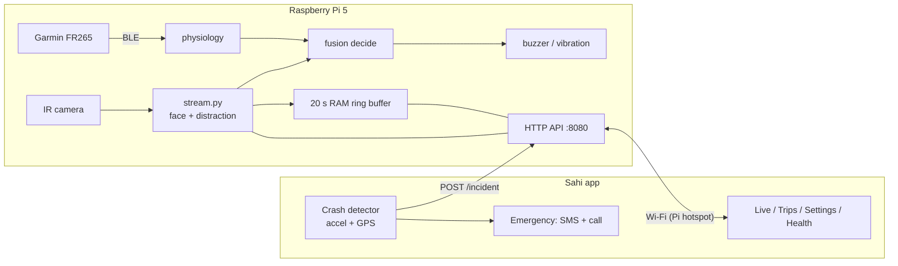
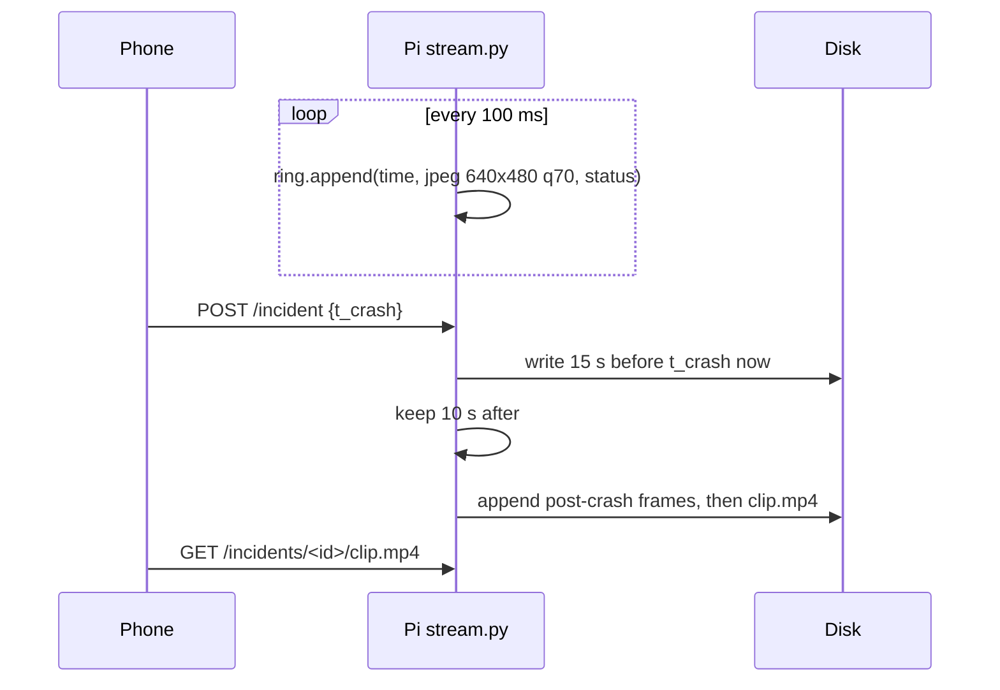

# Mobile App — Sahi (صاحي)

↑ [[Home]] | Model index: [[Models Index]] | Target: [[Raspberry Pi 5 Target]]

**Sahi** (صاحي, Egyptian Arabic for "awake / alert") is the driver's phone app for RTDMS. It shows
what the Pi sees and decides, adds the things the Pi cannot do on its own (GPS, internet, calls,
SMS, a screen), and turns a crash into an emergency call with a recorded clip.

> [!info] Status (2026-11-20): MVP code built, not yet run on a phone or against the real Pi
> The app is in `app/` (Expo SDK 58, TypeScript strict, Android development build): every MVP
> screen, the crash detector, the emergency flow, trips, demo mode and a mock Pi. Gates pass
> (types, lint, 55 unit + replay tests, expo-doctor 20/20, Android debug build). It has **not**
> been installed on a phone yet (no device or emulator was available to the build machine), and the
> Pi side of the contract (`/alert`, `/physio`, `/health`, the incident ring buffer, …) is not
> built: those endpoints exist only in `app/mock-pi/`. Status moves to `mvp-done` after the device
> checks in [VALIDATION](../app/docs/VALIDATION.md) pass. Evidence: [EVIDENCE](../app/docs/EVIDENCE.md).

## What's built

| Spec item | Where | State |
|---|---|---|
| 1 Connect + live view | `src/screens/pair.tsx`, `src/services/poller.ts`, `src/screens/live/` | QR pairing (joins + binds to the hotspot), typed address, 5 Hz polling, auto reconnect, offline banner, MJPEG view, driver state, eye / heart / phone groups |
| 2 Alerts + voice | `src/services/alerts.ts`, `src/pi/alert.ts` | from fusion's `AlertPattern` only: haptics, `ar-EG` / `en-US` voice, notification when the app is not on screen |
| 3 Crash detection | `src/crash/detector.ts`, `src/services/monitor.ts` | pure TS detector, 100 Hz background motion, GPS via a location foreground service |
| 4 Emergency | `src/app/sos.tsx`, `src/services/emergency.ts`, `modules/sahi-native/` | 30 s countdown, "I'm OK", SMS with a Maps link, then 123 or the first contact; manual hold-to-SOS |
| 5 Incident recording | `src/app/incident/[id].tsx` | `POST /incident`, clip list, play + download, sensor timeline: **against the mock only** (Pi side not built) |
| 6 Trips + safety score | `src/services/trips.ts`, `src/trips/score.ts`, Trips tab | SQLite, auto start / end with the Pi connection, per-trip summary and timeline, weekly trend |
| 7 Calibration + settings | `src/app/calibrate.tsx`, Settings tab | guided `POST /calibrate`, profiles, Pi-side thresholds / detectors (proposed `/settings`), app settings |
| 8 Pi health | Pi tab | proposed `/health`; `/status` fps + temperature used when the Pi lacks it |
| 9 Demo mode | `src/demo/`, `app/mock-pi/` | in-app replay with sample history and a fake crash; Node mock Pi serving the same scenario |

Code docs (one source of truth for each fact, not repeated here):
[README](../app/README.md) (install, run on a phone, mock / real Pi, gates) ·
[ARCHITECTURE](../app/docs/ARCHITECTURE.md) · [API](../app/docs/API.md) (the contract as built) ·
[DESIGN](../app/docs/DESIGN.md) · [VALIDATION](../app/docs/VALIDATION.md) · [EVIDENCE](../app/docs/EVIDENCE.md).

Branches: `app/scaffold` → `app/live-view` → `app/crash-sos-trips` (stacked PRs), skills on
`meta/mobile-skills`, this note on `docs/mobile-app`.

### Screens (web render of the dev build)

![[app/docs/screenshots/dark-en/05-live.png|200]] ![[app/docs/screenshots/dark-en/06-live-driving-lock.png|200]] ![[app/docs/screenshots/dark-en/14-sos.png|200]]
![[app/docs/screenshots/dark-en/07-trips.png|200]] ![[app/docs/screenshots/dark-en/09-health.png|200]] ![[app/docs/screenshots/dark-en/10-settings.png|200]]
![[app/docs/screenshots/light-ar/05-live.png|200]] ![[app/docs/screenshots/light-ar/15-incident.png|200]] ![[app/docs/screenshots/dark-en/01-consent.png|200]]

All 15 screens × dark / light × English / Arabic: `app/docs/screenshots/`.

## Why a phone app

| The Pi has | The phone adds |
|---|---|
| IR camera, all models, fusion, buzzer | Screen for live view, history, settings |
| No internet ([[Raspberry Pi 5 Target]]) | Internet, SMS, phone calls |
| No GPS | GPS location and speed |
| Bluetooth link to the Garmin | Accelerometer + gyroscope → crash detection |

## MVP

Build order: **1 → 2 → 7 → 8 → 9 → 3 → 4 → 5 → 6**

| # | Feature | What it does |
|---|---|---|
| 1 | **Connect + live view** | Join the Pi hotspot by QR code; live IR view; driver state (Alert / Distracted / Drowsy / Phone) |
| 2 | **Alerts + voice** | Phone notification with the buzzer; voice alerts in Arabic and English |
| 3 | **Crash detection** | Accelerometer spike > ~4 g + GPS speed drops to ~0; only armed during a trip above ~20 km/h |
| 4 | **Emergency** | 30 s countdown with "I'm OK" → SMS with GPS link to contacts → call 123 (ambulance) or first contact |
| 5 | **Incident recording** | Pi keeps the last 20 s in RAM; on crash saves 15 s before + 10 s after with sensor data; app downloads the clip |
| 6 | **Trip history + safety score** | Events per trip, alert counts, score trend |
| 7 | **Calibration + settings** | Guided calibration, driver profiles, sensitivity and thresholds, detectors on/off |
| 8 | **Pi health** | CPU, temperature, throttling, 5 V, fps, model status, restart / shutdown |
| 9 | **Demo mode** | Replay recorded `/status` data without the Pi, test-alert button, fake crash |

## Architecture



**Link:** the Pi runs a Wi-Fi hotspot (NetworkManager, `nmcli dev wifi hotspot`, Pi at
`10.42.0.1`). The phone joins it by scanning a QR code on the unit. Bluetooth is too slow for
video, and the Pi's Bluetooth is already used by the Garmin.

**Polling:** v0 polls `GET /status` at 5 Hz. `stream.py` already serves it, so no WebSocket is
needed yet. Move to a WebSocket only if polling proves too slow.

## Pi API contract (proposed)

| Method | Path | Status | Purpose |
|---|---|---|---|
| GET | `/stream.mjpg` | ✅ exists | Live view (JPEG encoded only while someone is watching) |
| GET | `/status` | ✅ exists | fps, face, drowsiness, hybrid (call / texting), ms, temp_c |
| POST | `/calibrate` | ✅ exists | Starts calibration (10 s eyes open, 3 s closed) |
| GET | `/alert` | 🆕 | Latest fusion decision: `{pattern, reasons, t}` (`AlertPattern` from `fusion/`) |
| GET | `/physio` | 🆕 | HR, RR, fatigue probability, watch connection |
| GET / PUT | `/settings` | 🆕 | Thresholds, sensitivities, detectors on/off |
| POST | `/test_alert` | 🆕 | `{pattern}`: fire a buzzer pattern for demo / testing |
| GET | `/health` | 🆕 | CPU, temp, throttled flags, 5 V, uptime, disk |
| POST | `/incident` | 🆕 | `{t_crash, g_peak, lat, lon}` → save the clip |
| GET | `/incidents` | 🆕 | List of saved incidents |
| GET | `/incidents/<id>/clip.mp4` | 🆕 | Download the clip |
| GET | `/incidents/<id>/data.jsonl` | 🆕 added | Per-frame status for the sensor timeline under the clip |
| POST | `/system/{restart,shutdown}` | 🆕 | Service control |

All 🆕 rows are served by `app/mock-pi/` and demo mode today; request / response JSON for every row:
[API](../app/docs/API.md). Rule kept: **fusion decides, the app only displays.** The app never applies its own thresholds to
model scores (see [[Models Index]] → "Models report, fusion decides").

## Crash detection (phone side)

1. **Armed** only when connected to the Pi and GPS speed > ~20 km/h.
2. **Impact:** accelerometer at 50–100 Hz, magnitude spike > ~4 g (starting value; tune it).
3. **Confirm:** GPS speed ~0 within ~5 s and stays there.
4. **Optional checks:** Pi reports face lost or sudden head movement; Garmin HR spike; gyro shows
   the phone flipped.
5. **Countdown:** full-screen 30 s alarm, "I'm OK" cancels.
6. **Escalate:** SMS with a Google Maps link to emergency contacts, then call 123 or the first
   contact.
7. **Log** the incident to trip history.

> [!warning] Platform limits
> - **Android:** works. Needs a foreground service, `SEND_SMS` and `CALL_PHONE`. Fine for a
>   sideloaded build, not a Play Store build.
> - **iOS:** an app cannot send an SMS or start a call without the user tapping. Build Android for
>   the project.
> - Phone must be in a mount. A loose phone gives useless accelerometer data.

**Testing (no real crashes):** replay recorded driving data with an injected 5–8 g spike; drop
tests in demo mode with speed faked; count false alarms on real drives (speed bumps, hard braking).

## Incident recording (Pi side)



- **Buffer:** `deque(maxlen=200)` = 20 s × 10 fps. ~30 KB per frame → **~6–8 MB RAM**. Nothing
  touches the SD card while driving.
- **Cost:** own JPEG encode at 10 fps, ~2–4 ms per frame → ~3% of one core. Needed because
  `stream.py` only encodes while a viewer is connected. Measure it with all models running, per
  `.cursor/rules/pi-performance-pipeline.mdc`.
- **Saved per incident** in `incidents/<time>/`:
  - `clip.avi`: MJPG, raw JPEG bytes, written immediately (no re-encode)
  - `clip.mp4`: converted afterwards at low priority (ffmpeg); phones cannot play MJPG AVI
  - `data.jsonl`: per-frame status, so the app can draw the overlay
  - `meta.json`: time, GPS, g peak
- **Why 20 s, not 15:** the phone's crash time reaches the Pi late over Wi-Fi.
- **Power loss in the crash:** write the pre-crash part first. A UPS HAT or supercap is worth
  adding to the BOM.

> [!important] Divergence from the report (Ethics)
> [[4.3 Ethics]] says no persistent storage of video. Incident recording stores 25 s of video on a
> crash, and only then. Mitigations: RAM-only buffer, saved only on a crash, consent screen,
> auto-delete after N days, locked against overwrite until exported. The final report must record
> this, together with GPS use from the emergency protocol in [[5.2 Phase Two Plan]].

## React Native stack

Expo with a **development build** (not Expo Go), because SMS and call need a small native module.

| Need | Library |
|---|---|
| Project, routing | Expo + `expo-router` |
| State | `zustand` |
| Live MJPEG view | `react-native-webview` showing an `` (RN `Image` does not stream MJPEG reliably on Android) |
| Polling `/status` | `fetch` every 200 ms |
| QR pairing | `expo-camera` (barcode scanning) |
| Accelerometer / gyro | ~~`expo-sensors`~~ → `sahi-native` (keeps running in the background, see divergences) |
| GPS + speed | `expo-location` (+ `expo-task-manager` for background) |
| Keep running in background | ~~`@notifee/react-native`~~ → `expo-location` foreground service |
| Notifications | ~~`@notifee/react-native`~~ → `sahi-native` (`NotificationCompat`) |
| Voice alerts | `expo-speech` (`ar-EG` / `en-US`, depends on installed voices) |
| Vibration | `expo-haptics` + RN `Vibration` |
| Auto SMS + call | Small native module via Expo config plugin (Android `SmsManager`, `ACTION_CALL`) |
| Trips / incidents DB | `expo-sqlite` |
| PIN, contacts | `expo-secure-store` |
| Clip playback | `expo-video` |
| Charts | ~~`victory-native`~~ → plain Views |
| Native controls | `@expo/ui` (Jetpack Compose switches, sliders, pickers), `NativeTabs`, `expo-symbols` icons |

### Screens

```
app/
├─ (onboarding)/   consent, permissions, pair (QR), emergency contacts
├─ (tabs)/
│  ├─ live.tsx      camera view, state, EAR / PERCLOS / HR, alert level
│  ├─ trips.tsx     history, safety score
│  ├─ health.tsx    Pi health
│  └─ settings.tsx  calibration, profiles, thresholds, demo mode
├─ incident/[id].tsx  clip + sensor timeline + map
└─ sos.tsx          countdown + "I'm OK"
```

> [!tip] Driver safety
> Lock the live screen while the car moves (GPS speed > ~10 km/h): show only a big state
> indicator. The app must not distract the driver.

## Divergences from this spec

Each one is a decision taken while building, with the reason. The spec text above is left as
written so the change is visible.

> [!important] `@notifee/react-native` → `sahi-native` notifications + `expo-location` foreground service
> notifee's last release is from December 2024 (two years old, pre-RN 0.88), so it fails the
> "maintained" check. `expo-notifications` was the next candidate but bundles Firebase Cloud
> Messaging, which conflicts with "no cloud". Notifications are ~40 lines of `NotificationCompat`
> in the local module (two channels: alerts, and SOS with an alarm sound and a full-screen intent);
> the process is kept alive by `expo-location`'s own foreground service (type `location`), which
> the GPS needs anyway.

> [!important] `expo-sensors` → accelerometer + gyroscope in `sahi-native`
> `expo-sensors` unregisters its listeners on `onHostPause` (`SensorProxy.kt`), so crash detection
> would stop as soon as the screen turns off. The module samples at 100 Hz on its own thread and
> sends one batch to JS every 200 ms; the detector itself stays a pure TS function.

> [!important] "EAR" on the live screen → eye openness
> `stream.py` does not expose the eye aspect ratio. It exposes `drowsiness.openness` (calibrated,
> smoothed); the app shows that as "Eye openness". `hybrid.ear` is the *phone-at-ear* probability
> and is not shown as an eye metric.

> [!important] Alerts on the phone need the Pi's `/alert`
> The app never derives an alert from scores, so with today's `stream.py` (no `/alert`) the phone
> shows the driver state but stays silent and says so in a banner; the Pi buzzer is unaffected.
> Phone alerts start working as soon as the Pi serves fusion's decision.

> [!important] Contract details added by the app
> `GET /incidents/<id>/data.jsonl` (needed for the sensor timeline); `/physio` reuses the names of
> `models/physiology` `HrvSnapshot.to_dict()`; `t_crash` is in **ms** of the phone clock; the
> pairing QR is a standard Wi-Fi QR plus a `U:` base-URL field (any camera can still join the
> hotspot). Details in [API](../app/docs/API.md). Needs the owners' agreement (Open questions).

> [!important] Backlog items built for the MVP
> The brief for this build asked for **manual SOS**, **pause monitoring** and **delete all data**,
> which this note lists under Backlog. They are built (hold-to-SOS 2 s + 10 s countdown; pause stops
> polling, trips, alerts and crash detection; delete wipes SQLite, secure storage and settings).
> Live HR / RR with signal quality and the fatigue score are shown too. The rest of the Backlog is
> untouched.

> [!important] Smaller choices
> - `victory-native` → two small View-based charts (weekly score, HR trend): no Skia for two bar charts.
> - Driving lock: locks above 10 km/h, unlocks below 7 km/h (hysteresis, no flicker at 10).
> - A trip ends after 60 s offline, so a Wi-Fi drop does not split a trip.
> - Crash optional checks (flip, face lost, head jerk, HR spike) are recorded, never required:
>   waiting for them would only delay help. GPS lost → no automatic detection (banner); manual SOS stays.
> - `/alert` is polled at 5 Hz together with `/status`, `/physio` at 1 Hz, `/health` only on the Pi tab.
> - Colors: a fixed palette instead of Material You dynamic colors, so alert colors mean the same on
>   every phone ([DESIGN](../app/docs/DESIGN.md)).
> - Route names `(onboarding)/connect` and `(onboarding)/emergency-contacts` (the spec's `pair` /
>   `contacts` collide with the same screens reachable from Settings); each tab is a native stack.
> - Screenshots and UI checks come from the Expo **web** build: no Android emulator could run on the
>   build machine (no KVM).

## Backlog (after MVP)

Manual SOS, pause monitoring and delete all data are built (see above); everything else here is not.

- **Live:** gaze and head-pose display, mesh on/off, HRV live chart
- **Alerts:** "take a break" with nearby rest stops, snooze limits
- **Emergency:** nearest hospital, manual SOS, notify contacts of a high-fatigue trip
- **Trips:** route map, fatigue pattern ("drowsy after 90 min"), PDF / CSV export
- **Calibration:** camera-alignment helper, glasses / sunglasses check
- **Garmin:** battery, packet loss, loose-strap warning, baseline HR recording
- **Pi:** update over git bundle from the phone, log download, model switch v1 / v2
- **Privacy:** pause monitoring, delete all data, PIN lock
- **Fleet mode (B2B):** manager dashboard, driver ranking. Needs a cloud backend → conflicts with
  the no-cloud rule; opt-in, future work only.
- **Extras:** Android Auto view, widget, streaks / badges, road-facing phone recording (second
  view), onboarding tutorial

## Open questions

- [ ] Agree on the API contract in [API](../app/docs/API.md) with the `models/distraction` and
      `fusion/` owners, incl. the added `data.jsonl`, the `/physio` shape and `t_crash` in ms
- [x] Who owns `app/` and which branch prefix → `app/<topic>`, added to `git-branching.mdc` (owner still TBD)
- [ ] Build the Pi side (`phone/incident-buffer`: endpoints + 20 s ring buffer behind `--incident-buffer`)
- [ ] Measure ring-buffer cost on the Pi with all models running (not measured: nothing built yet)
- [ ] First install on a mid-range Android phone; run the device checks D1–D12 and manual crash
      tests M1–M5 in [VALIDATION](../app/docs/VALIDATION.md)
- [ ] UPS / supercap for the Pi: add to [[4.5 Cost Calculation and BOM]]?
- [ ] Final report: [[4.3 Ethics]] must record the incident video (25 s, only after a crash) and GPS
      in the SOS SMS; [[5.2 Phase Two Plan]]'s emergency protocol now runs on the phone (the
      transcription in `Report/` stays verbatim: the change goes in the final report)
- [ ] Hotspot setup on the Pi (`nmcli dev wifi hotspot`, `10.42.0.1`) and the printed QR label
