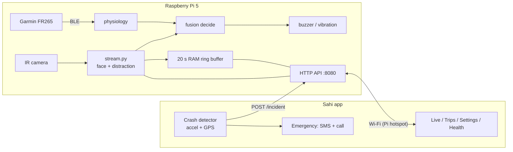
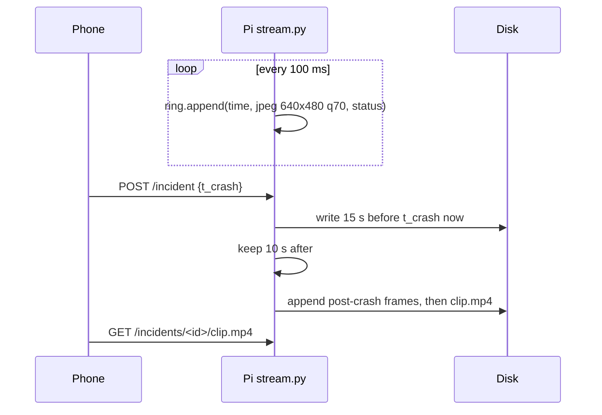

# Mobile App — Sahi (صاحي)

↑ [[Home]] | Model index: [[Models Index]] | Target: [[Raspberry Pi 5 Target]]

**Sahi** (صاحي, Egyptian Arabic for "awake / alert") is the driver's phone app for RTDMS. It shows
what the Pi sees and decides, adds the things the Pi cannot do on its own (GPS, internet, calls,
SMS, a screen), and turns a crash into an emergency call with a recorded clip.

> [!info] Status: planned, nothing built yet
> No app code exists. The Pi-side endpoints below are a **proposed contract**: only
> `/stream.mjpg`, `/status` and `POST /calibrate` exist today (in
> `models/distraction/scripts/stream.py`, port 8080). Per the branching rule, agree on this note
> before both sides implement.

## Why a phone app

| The Pi has | The phone adds |
|---|---|
| IR camera, all models, fusion, buzzer | Screen for live view, history, settings |
| No internet ([[Raspberry Pi 5 Target]]) | Internet, SMS, phone calls |
| No GPS | GPS location and speed |
| Bluetooth link to the Garmin | Accelerometer + gyroscope → crash detection |

## MVP

Build order: **1 → 2 → 7 → 8 → 9 → 3 → 4 → 5 → 6**

| # | Feature | What it does |
|---|---|---|
| 1 | **Connect + live view** | Join the Pi hotspot by QR code; live IR view; driver state (Alert / Distracted / Drowsy / Phone) |
| 2 | **Alerts + voice** | Phone notification with the buzzer; voice alerts in Arabic and English |
| 3 | **Crash detection** | Accelerometer spike > ~4 g + GPS speed drops to ~0; only armed during a trip above ~20 km/h |
| 4 | **Emergency** | 30 s countdown with "I'm OK" → SMS with GPS link to contacts → call 123 (ambulance) or first contact |
| 5 | **Incident recording** | Pi keeps the last 20 s in RAM; on crash saves 15 s before + 10 s after with sensor data; app downloads the clip |
| 6 | **Trip history + safety score** | Events per trip, alert counts, score trend |
| 7 | **Calibration + settings** | Guided calibration, driver profiles, sensitivity and thresholds, detectors on/off |
| 8 | **Pi health** | CPU, temperature, throttling, 5 V, fps, model status, restart / shutdown |
| 9 | **Demo mode** | Replay recorded `/status` data without the Pi, test-alert button, fake crash |

## Architecture



**Link:** the Pi runs a Wi-Fi hotspot (NetworkManager, `nmcli dev wifi hotspot`, Pi at
`10.42.0.1`). The phone joins it by scanning a QR code on the unit. Bluetooth is too slow for
video, and the Pi's Bluetooth is already used by the Garmin.

**Polling:** v0 polls `GET /status` at 5 Hz. `stream.py` already serves it, so no WebSocket is
needed yet. Move to a WebSocket only if polling proves too slow.

## Pi API contract (proposed)

| Method | Path | Status | Purpose |
|---|---|---|---|
| GET | `/stream.mjpg` | ✅ exists | Live view (JPEG encoded only while someone is watching) |
| GET | `/status` | ✅ exists | fps, face, drowsiness, hybrid (call / texting), ms, temp_c |
| POST | `/calibrate` | ✅ exists | Starts calibration (10 s eyes open, 3 s closed) |
| GET | `/alert` | 🆕 | Latest fusion decision: `{pattern, reasons, t}` (`AlertPattern` from `fusion/`) |
| GET | `/physio` | 🆕 | HR, RR, fatigue probability, watch connection |
| GET / PUT | `/settings` | 🆕 | Thresholds, sensitivities, detectors on/off |
| POST | `/test_alert` | 🆕 | `{pattern}`: fire a buzzer pattern for demo / testing |
| GET | `/health` | 🆕 | CPU, temp, throttled flags, 5 V, uptime, disk |
| POST | `/incident` | 🆕 | `{t_crash, g_peak, lat, lon}` → save the clip |
| GET | `/incidents` | 🆕 | List of saved incidents |
| GET | `/incidents/<id>/clip.mp4` | 🆕 | Download the clip |
| POST | `/system/{restart,shutdown}` | 🆕 | Service control |

Rule kept: **fusion decides, the app only displays.** The app never applies its own thresholds to
model scores (see [[Models Index]] → "Models report, fusion decides").

## Crash detection (phone side)

1. **Armed** only when connected to the Pi and GPS speed > ~20 km/h.
2. **Impact:** accelerometer at 50–100 Hz, magnitude spike > ~4 g (starting value; tune it).
3. **Confirm:** GPS speed ~0 within ~5 s and stays there.
4. **Optional checks:** Pi reports face lost or sudden head movement; Garmin HR spike; gyro shows
   the phone flipped.
5. **Countdown:** full-screen 30 s alarm, "I'm OK" cancels.
6. **Escalate:** SMS with a Google Maps link to emergency contacts, then call 123 or the first
   contact.
7. **Log** the incident to trip history.

> [!warning] Platform limits
> - **Android:** works. Needs a foreground service, `SEND_SMS` and `CALL_PHONE`. Fine for a
>   sideloaded build, not a Play Store build.
> - **iOS:** an app cannot send an SMS or start a call without the user tapping. Build Android for
>   the project.
> - Phone must be in a mount. A loose phone gives useless accelerometer data.

**Testing (no real crashes):** replay recorded driving data with an injected 5–8 g spike; drop
tests in demo mode with speed faked; count false alarms on real drives (speed bumps, hard braking).

## Incident recording (Pi side)



- **Buffer:** `deque(maxlen=200)` = 20 s × 10 fps. ~30 KB per frame → **~6–8 MB RAM**. Nothing
  touches the SD card while driving.
- **Cost:** own JPEG encode at 10 fps, ~2–4 ms per frame → ~3% of one core. Needed because
  `stream.py` only encodes while a viewer is connected. Measure it with all models running, per
  `.cursor/rules/pi-performance-pipeline.mdc`.
- **Saved per incident** in `incidents/<time>/`:
  - `clip.avi`: MJPG, raw JPEG bytes, written immediately (no re-encode)
  - `clip.mp4`: converted afterwards at low priority (ffmpeg); phones cannot play MJPG AVI
  - `data.jsonl`: per-frame status, so the app can draw the overlay
  - `meta.json`: time, GPS, g peak
- **Why 20 s, not 15:** the phone's crash time reaches the Pi late over Wi-Fi.
- **Power loss in the crash:** write the pre-crash part first. A UPS HAT or supercap is worth
  adding to the BOM.

> [!important] Divergence from the report (Ethics)
> [[4.3 Ethics]] says no persistent storage of video. Incident recording stores 25 s of video on a
> crash, and only then. Mitigations: RAM-only buffer, saved only on a crash, consent screen,
> auto-delete after N days, locked against overwrite until exported. The final report must record
> this, together with GPS use from the emergency protocol in [[5.2 Phase Two Plan]].

## React Native stack

Expo with a **development build** (not Expo Go), because SMS and call need a small native module.

| Need | Library |
|---|---|
| Project, routing | Expo + `expo-router` |
| State | `zustand` |
| Live MJPEG view | `react-native-webview` showing an `` (RN `Image` does not stream MJPEG reliably on Android) |
| Polling `/status` | `fetch` every 200 ms |
| QR pairing | `expo-camera` (barcode scanning) |
| Accelerometer / gyro | `expo-sensors` |
| GPS + speed | `expo-location` (+ `expo-task-manager` for background) |
| Keep running in background | `@notifee/react-native` foreground service (Android) |
| Notifications | `@notifee/react-native` |
| Voice alerts | `expo-speech` (`ar-EG` / `en-US`, depends on installed voices) |
| Vibration | RN `Vibration` |
| Auto SMS + call | Small native module via Expo config plugin (Android `SmsManager`, `ACTION_CALL`) |
| Trips / incidents DB | `expo-sqlite` |
| PIN, contacts | `expo-secure-store` |
| Clip playback | `expo-video` |
| Charts | `victory-native` |

### Screens

```
app/
├─ (onboarding)/   consent, permissions, pair (QR), emergency contacts
├─ (tabs)/
│  ├─ live.tsx      camera view, state, EAR / PERCLOS / HR, alert level
│  ├─ trips.tsx     history, safety score
│  ├─ health.tsx    Pi health
│  └─ settings.tsx  calibration, profiles, thresholds, demo mode
├─ incident/[id].tsx  clip + sensor timeline + map
└─ sos.tsx          countdown + "I'm OK"
```

> [!tip] Driver safety
> Lock the live screen while the car moves (GPS speed > ~10 km/h): show only a big state
> indicator. The app must not distract the driver.

## Backlog (after MVP)

- **Live:** gaze and head-pose display, mesh on/off, HRV live chart
- **Alerts:** "take a break" with nearby rest stops, snooze limits
- **Emergency:** nearest hospital, manual SOS, notify contacts of a high-fatigue trip
- **Trips:** route map, fatigue pattern ("drowsy after 90 min"), PDF / CSV export
- **Calibration:** camera-alignment helper, glasses / sunglasses check
- **Garmin:** battery, packet loss, loose-strap warning, baseline HR recording
- **Pi:** update over git bundle from the phone, log download, model switch v1 / v2
- **Privacy:** pause monitoring, delete all data, PIN lock
- **Fleet mode (B2B):** manager dashboard, driver ranking. Needs a cloud backend → conflicts with
  the no-cloud rule; opt-in, future work only.
- **Extras:** Android Auto view, widget, streaks / badges, road-facing phone recording (second
  view), onboarding tutorial

## Open questions

- [ ] Agree on the API contract with the `models/distraction` and `fusion/` owners
- [ ] Who owns `app/` and which branch prefix (`app/<topic>`?) → add to `git-branching.mdc`
- [ ] Measure ring-buffer cost on the Pi with all models running
- [ ] UPS / supercap for the Pi: add to [[4.5 Cost Calculation and BOM]]?
- [ ] Update [[4.3 Ethics]] for incident recording + GPS
