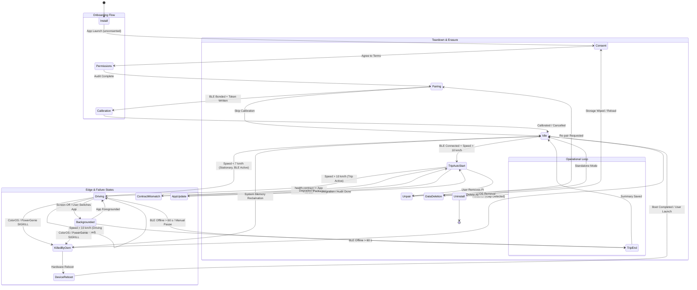

# Sahi App Lifecycle Design Document

## 1. Overview and Target Environment

Sahi is an Android driver-monitoring companion application for a Raspberry Pi 5 unit mounted in a vehicle. The application is built with Expo SDK 58 (React Native 0.88, Hermes, New Architecture, TypeScript strict) and includes a local Kotlin native module (`modules/sahi-native`).

### 1.1 Target Device Constraints

#### 1.1.1 Current Hardware Reference: realme GT 6T (RMX3853)
The CURRENT primary test phone is a realme GT 6T (model `RMX3853`):
- Operating System: Android 16 (SDK 36) with ColorOS.
- Chipset: Qualcomm Snapdragon 7+ Gen 3.
- Services: Google Play services present. However, Sahi strictly maintains a zero-cloud boundary and **never assumes GMS in code** (no Play Services APIs, no Firebase Cloud Messaging / FCM).
- Android 12+ Permission Architecture:
  - Bluetooth: Runtime `BLUETOOTH_SCAN` and `BLUETOOTH_CONNECT` permissions (Android 12+ / SDK 31+).
  - Notifications: Runtime `POST_NOTIFICATIONS` permission (Android 13+ / SDK 33+).
  - Foreground Service Location Constraint: Foreground-service type location (`FOREGROUND_SERVICE_LOCATION`, Android 14+ / SDK 34+) strictly requires while-in-use location (`ACCESS_FINE_LOCATION` or `ACCESS_COARSE_LOCATION`) to be granted *prior* to launching the foreground service (Android 16 enforcement: unverified, test on device).
- Power Management & Background Reclamation (ColorOS):
  - Aggressive proprietary OEM process reclamation (ColorOS battery optimization, "Allow background activity", and "Auto-launch" controls). ColorOS restricts background tasks, background Bluetooth scanning, and foreground service execution unless explicitly configured by the user (Android 16 behavior: unverified, test on device).

#### 1.1.2 Reference / Returning Target: Huawei Y9a (FRL-L22) & Generic No-GMS
The secondary/returning reference test target is a Huawei Y9a (model `FRL-L22`):
- Operating System: Android 10 with EMUI 10.1.
- Chipset: MediaTek Helio G80.
- Services: No Google Mobile Services (GMS), no Google Play Services, HMS only, no Firebase Cloud Messaging (FCM).
- Power Management: Aggressive proprietary OEM process reclamation (EMUI PowerGenie). EMUI terminates background tasks, ignores standard Android foreground service conventions if deemed power-intensive, and blocks standard system broadcast intents (including `BOOT_COMPLETED`) unless manually configured by the user.
- Generic No-GMS Column: Pure AOSP and de-Googled devices operate under standard Linux Low Memory Killer (LMK) and platform Doze without push fallbacks. Because the Huawei device may return and Sahi targets generic de-Googled environments, code must never assume GMS.

### 1.2 Core Architectural Principles
1. Audience & Scope: The audience is the driver of a personal car (`.cursor/rules/end-user-product.mdc`). Three tabs: **Drive**, **Trips**, **Settings**. Engineering items (hardware metrics, numeric thresholds, detector toggles, manual address entry, demo mode) live in a hidden Diagnostics screen (tap version 7 times in Settings > About).
2. Local-Only Boundary: Zero cloud dependencies, zero external analytics, zero remote push services. All telemetry, contacts, and tokens remain strictly between the phone and your Sahi unit. Never assume Google Mobile Services (GMS) in code, even when running on devices with Google Play services present.
3. English-Only Application: The application interface, consent statement, voice prompt cues, system notifications, and documentation are strictly English only.
4. Hybrid Link Split (`contracts/pi-link/CONTRACT.md`, `Subsystems/Phone-Pi Link.md`):
   - Bluetooth Low Energy (BLE): Always-on control, safety, and telemetry plane. Unit acts as GATT peripheral; phone acts as central. Carries alerts, status, physiology, clock synchronization, settings, and crash incident trigger writes.
   - Wi-Fi Hotspot: High-bandwidth bulk data plane only. Connects solely for setup/calibration video alignment and recorded incident clip downloads (`/incidents/*`). Live camera video is never streamed on the Drive tab while driving. The network is unbound immediately when not in active use.
5. Separation of Safety Detection from Connectivity: Crash detection and emergency escalation execute entirely on the phone using device sensors (IMU at 100 Hz, GPS speed). They do not depend on the unit link being online.
6. Strict Parsing Policy (`app/src/pi/parse.ts`): Malformed payloads, missing required fields, or unsupported contract versions yield `null`. The application never guesses, interpolates, or displays synthesized defaults.

---

## 2. Top-Level State Machine

### 2.1 State Diagram (`stateDiagram-v2`)

### 2.2 Global State Transition Table

| Current State | Trigger / Event | Target State | Actions & Side Effects |
|---|---|---|---|
| `install` | Process startup; `onboarded === false`, `consentedAt === null` | `consent` | Verify SQLite tables; route to `/(onboarding)/consent` (`app/src/app/index.tsx`). |
| `consent` | User taps "Agree" | `permissions` | Write `consentedAt = Date.now()` to KV-store; route to `/(onboarding)/permissions`. |
| `permissions` | User completes review / requests permissions | `pairing` | Audit system permissions (Android 12+ BLE, notifications, while-in-use location, phone/SMS); route to `/(onboarding)/connect` or `/pair`. |
| `pairing` | QR scanned, BLE bonded, auth token written to char `0x09` | `calibration` or `idle` | Save Wi-Fi PSK and BLE token to SecureStore; sync clock; route to `/calibrate` or tabs. |
| `calibration` | Calibration finishes or user exits | `idle` | Send `POST /calibrate`; unbind Wi-Fi; route to Drive tab. |
| `idle` | BLE connected AND GPS speed > 10 km/h | `trip auto-start` | Acquire wake lock; create trip row in SQLite; start location foreground service (requires prior while-in-use location grant; Android 16 behavior: unverified, test on device). |
| `trip auto-start` | Trip record created in SQLite | `driving` | Subscribe to BLE notifies; start 100 Hz IMU; arm crash monitor if speed > 20 km/h. |
| `driving` | Speed > 10 km/h | `driving` (locked) | Hide tabs and metrics; display full-screen state and hold-to-SOS (`useDrivingLock.ts`). |
| `driving` | Speed < 7 km/h | `driving` (unlocked) | Restore metrics and tabs; driving lock disengaged. |
| `driving` | Home pressed / screen locked | `backgrounded` | Keep foreground service, 100 Hz IMU, and BLE active; post ongoing notification. |
| `backgrounded` | User returns app to foreground | `driving` | Restore screen rendering; re-evaluate driving lock. |
| `driving` / `backgrounded` | BLE disconnected > 60 s OR manual pause | `trip end` | Close open trip in SQLite; calculate safety score; stop foreground service and IMU. |
| `trip end` | Cleanup complete | `idle` | Set `tripId = null`; release wake lock; display trip card. |
| `driving` / `backgrounded` | OS OEM battery manager terminates process (`SIGKILL` via ColorOS / PowerGenie) | `killed by OEM` | Hardware drops link; heartbeat ceases; process dies silently without `onDestroy()`. (Android 16 kill behavior: unverified, test on device). |
| `killed by OEM` | User launches app from launcher | `idle` | Detect heartbeat gap; show pause banner; close stale trip in SQLite. |
| `Any` | Device powers off or restarts | `device reboot` | OS halts; on startup broadcasts `BOOT_COMPLETED` (if permitted by ColorOS / EMUI auto-launch controls; Android 16 delivery: unverified, test on device). |
| `device reboot` | `BOOT_COMPLETED` received or app launched | `idle` | Close stale trip; inspect heartbeat gap; re-arm monitoring if enabled. (Android 16 startup: unverified, test on device). |
| Any active | Package update installed (`MY_PACKAGE_REPLACED`) | `app update` | Run SQLite schema migrations; re-audit permissions (Android 12+ BLE, notification, while-in-use location) and battery exemptions. |
| `idle` / `driving` | `health.contract != app version` | `contract mismatch` | Display "Pi software mismatch" banner; keep compatible characteristics; drop invalid ones. |
| Any operational | User selects "Forget this unit" in Settings -> Your Sahi unit | `unpair` | Clear BLE token and Wi-Fi credentials from SecureStore; disconnect BLE link. |
| Any operational | User selects "Delete all data" in Settings -> Privacy and my data | `uninstall & deletion` | Wipe SQLite tables; wipe SecureStore; clear KV-store; restart app via `reloadAppAsync`. |
| Any | User uninstalls application via Android OS | `uninstall & deletion` | OS deletes application sandbox; Pi token remains until rotated on Pi. |

---

## Contents

- [Lifecycle states 1-8: install to driving](lifecycle/states-setup.md)
- [Lifecycle states 9-16: trip end to data deletion](lifecycle/states-running.md)
- [Lifecycle hard cases](lifecycle/hard-cases.md)
- [Lifecycle open questions](lifecycle/open-questions.md)
