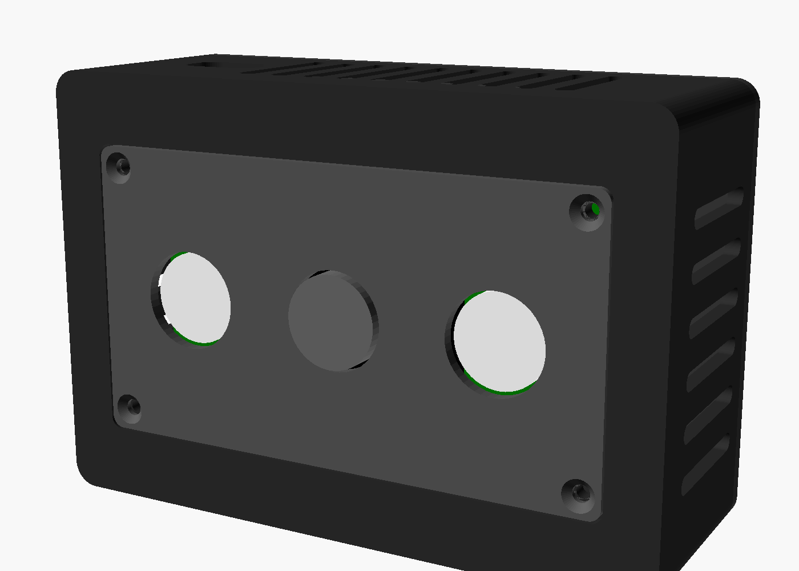
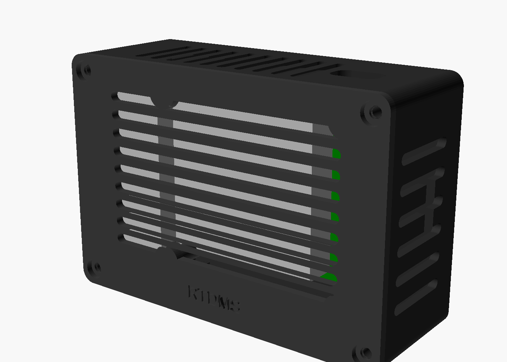
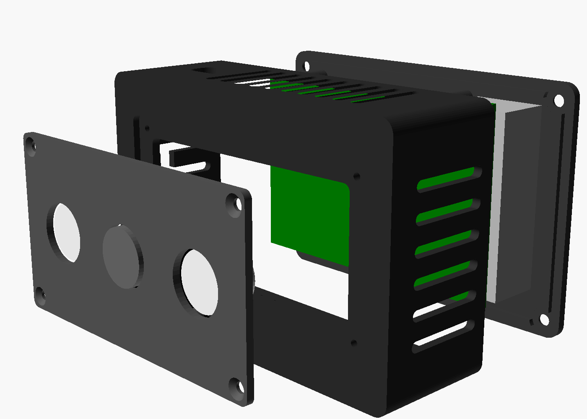
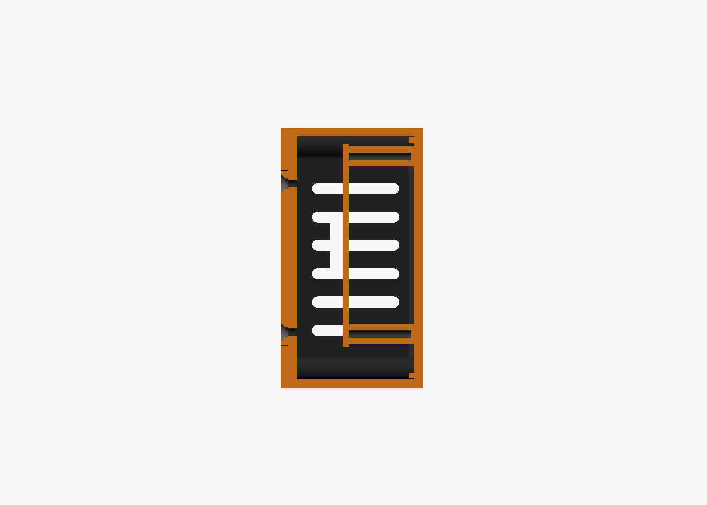

# RTDMS enclosure (Pi 5 + IR camera)

A 3D-printable dash-cam box for the Raspberry Pi 5 with its Active Cooler and the HBV OV5647 160°
IR camera with the two IR LED boards. There is no AI HAT. Openings are only for **power** and **airflow**.

| Front (faces the driver) | Back (fan intake) |
|---|---|
|  |  |
|  |  |

**Outer size: 105.8 × 71.8 × 39.2 mm.** Source: `rtdms_enclosure.scad` (OpenSCAD, fully
parametric). After changing a parameter, run `./render.sh` to rebuild `stl/` and `renders/`.

## Layout

- **Front:** a separate *camera plate* holds the camera, with holes for the lens and the two IR LED
  domes. Four countersunk screws fix it into a flush recess.
- **Inside:** the Pi stands upright behind the camera. The board's underside faces the camera and
  the cooler faces the back.
- **Back (lid):** the Pi screws onto 18 mm standoffs on the lid. A slotted grille sits right over
  the Active Cooler, so the fan draws outside air with about 5 mm of clearance.
- **Top:** a USB-C cut-out sized for an overmoulded plug, such as the official 27 W supply, plus
  vent slots. Hot air rises out of the top.
- **Sides and bottom:** exhaust vent slots. A microSD access slot is in the right-hand wall, seen
  from the back.
- **Bottom:** a captive **1/4"-20 nut**, so any tripod, suction-cup or ball-head phone mount screws in.
- The ribbon runs from the top of the camera over the Pi's top edge to the CSI connector.

## Before printing: measure the camera (calipers)

The camera is a no-name module and its datasheet wasn't available. The Pi 5 numbers are the
standard footprint, but **every `MEASURE` parameter in the `.scad` file is a guess.** Measure these:

| Parameter | What to measure |
|---|---|
| `cam_pcb` | Camera board width × height |
| `cam_holes` | Distance between mounting-hole centres, horizontally and vertically |
| `lens_d` | Widest diameter of the lens (front glass or barrel) |
| `lens_h` | Lens tip height above the camera board's front face |
| `led_d` | IR LED dome diameter |
| `led_dx`, `led_dy` | LED centre offset from the lens centre (sideways, up/down) |
| `ir_env` | Whole camera + IR board outline, width × height (it must pass through the front opening) |

Then **print `camera_plate.stl` first**: it's small, about 8 cm³, roughly 20–30 min. Screw the
camera onto it and check the fit. Only then print the shell and lid.

## Print settings

- **Material: PETG or ASA. Not PLA.** A parked car's dash in Egyptian summer goes far past PLA's
  ~55 °C softening point.
- 0.2 mm layers, 0.4 mm nozzle, 4 walls, 20–25 % infill.
- `shell.stl`: print camera face down. The recess and opening print without support; the top-wall
  USB-C hole may want "support on build plate only".
- `lid.stl`: export is already flipped, outer face down, standoffs up. No support.
- `camera_plate.stl`: front face down, standoffs up. No support.

## Hardware

| Qty | Part | Use |
|---|---|---|
| 4 | M2.5 × 6 pan-head | Pi → lid standoffs (self-tapping into 2.1 mm pilots) |
| 4 | M2 × 5 | camera board → plate standoffs (1.7 mm pilots) |
| 4 | M2.5 × 8 countersunk | camera plate → shell |
| 4 | M3 × 10 | lid → shell corner posts (2.5 mm pilots) |
| 1 | 1/4"-20 hex nut | tripod mount (press into the pocket from inside) |

## Assembly

1. Press the 1/4"-20 nut into its pocket in the bottom of the shell.
2. Screw the camera onto the camera plate, LEDs through their holes, and attach the ribbon.
3. Feed the ribbon through the front opening and screw the plate into the recess.
4. Screw the Pi onto the lid standoffs, cooler facing the grille. Connect the ribbon to the CSI port.
5. Fold the ribbon over the Pi's top edge and close the lid with the 4 M3 screws.
6. Plug in USB-C through the top.

## Notes and options

- The IR boards' light sensors sit behind the plate, so the LEDs will likely stay on all the time.
  That is fine, even good, for a driver-monitoring IR camera.
- If the image comes out upside down, fix it in software (libcamera `rotation=180`). No reprint needed.
- `open_usb_eth = true` cuts an opening for the USB-A and Ethernet ports (off by default).
  `sd_slot` and `tripod_mount` can be switched off.
- Not verified yet: the real camera dimensions and a printed test fit. The internal clearances
  (USB stack 16.5 mm, 2 mm top gap for the plug and ribbon) come from the standard Pi 5 footprint.
