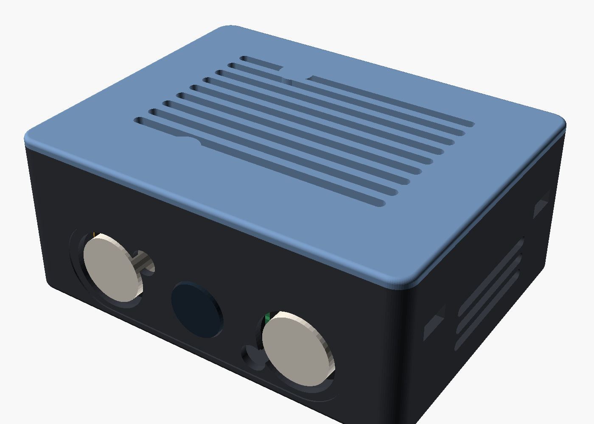
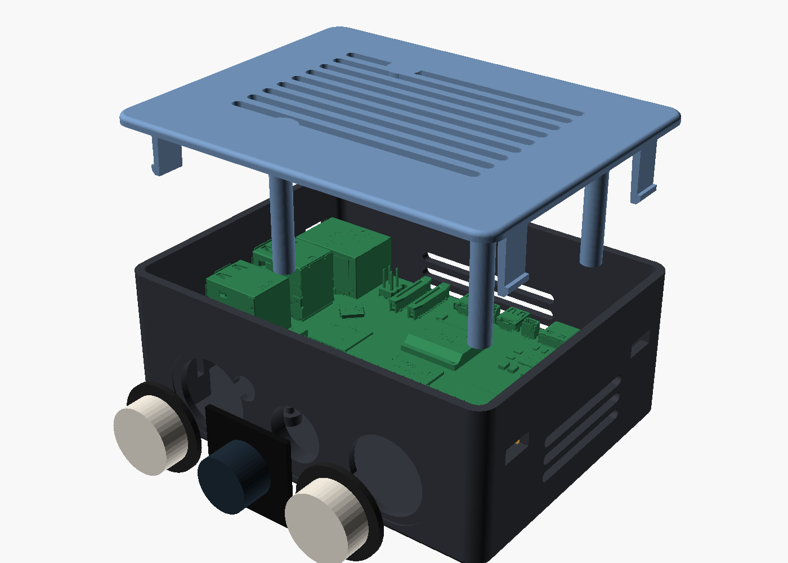

# Brick Snap: the Brick enclosure with no screws

Same outer box as [`../brick/`](../brick/README.md): **108.8 × 85 × 45 mm**, Pi 5 + Active Cooler flat,
IR camera on the front wall, USB-C and vents only. Same Pi and camera positions, so the camera
openings, USB-C hole and vents are unchanged. **Only the way parts are held changed. No screws, no nuts, no glue.**

| Assembled | Exploded |
|---|---|
|  |  |

## How each part is held

| Part | Before | Now |
|---|---|---|
| **Lid** | 5 screws | **4 snap arms** hang from the lid and click into 4 windows in the side walls (2 per side). |
| **Pi 5** | 4 screws | **4 pins** on the standoffs go through the board's holes. **4 posts** under the lid stop 0.2 mm above the board and keep it down. |
| **Camera clips** | 2 screws | Each clip **slides in from the top** into a slot at the outer end of the front wall and is clamped there. |

### Lid
- The arms are tapered (2.2 mm at the root, 1.6 mm at the tip), 16.5 mm long, 8 mm wide. Each has a hook that sticks out 1.0 mm.
  Closing the lid bends each arm in by 0.7 mm; calculated strain at the root is **0.9 %**.
- The window is cut **through** the wall. To open the lid, push each hook in from outside with a small
  screwdriver or a card edge, and lift. 4 hooks, 4 windows, 2 sides.
- The lid's lip still centres it in the box (0.3 mm clearance), as in the screw version.

### Pi 5
- Pin Ø2.4 in the Pi's Ø2.7 holes; the pin pokes 0.8 mm through the board. The post has a Ø3.4 recess for the pin tip.
- The post end sits **0.2 mm above the board**: it doesn't press, so it can't bend the board or load the pins.
  If the Pi rattles, stick 1 mm foam tape on the post ends.
- Slide the Pi onto the pins before the lid goes on. The USB-C end faces the back as before.

### Optional: hold the Pi with its own 4 screws
If you would rather screw the Pi down (the Pi's holes are 58 × 49 mm apart, M2.5), print
`out/print/shell_pi_screws.stl` and `out/print/lid_pi_screws.stl` **instead of** `shell.stl` and `lid.stl`
(the clips are the same). The standoffs have Ø2.8 holes, 4.5 mm deep, instead of pins, and the lid has
no posts (the screw heads would hit them). Use **4 × M2.5 × 5-6 mm** screws; a longer one pokes through the floor.
The lid still snaps on and the clips still slide in, so only these 4 screws remain. The holes are 2.8 mm
as in `../brick/`, so the screws only clamp (see the note there).

### Camera clips
- The clip is the same leaf spring as before: pad on the IR board, 0.3 mm of preload, but 2.0 mm thick (was 2.5)
  and 10 mm tall (was 12) so it's softer. Its outer end sits in a slot: a front face, a back lip and a bottom stop.
- **Order:** camera in from inside, then drop each clip in from the top. This works with the Pi already installed,
  which the screw version didn't allow.
- Right side: the clip as printed. Left side: the same clip turned upside down (pad still facing the front).
- If it rattles, stick 1 mm foam tape on the pads.

## Parts to print

| Part | File | How many |
|---|---|---|
| Shell | `out/print/shell.stl` (or `shell_pi_screws.stl`) | 1 (open side up) |
| Lid | `out/print/lid.stl` (or `lid_pi_screws.stl`) | 1 (already flipped: outer face down, arms and posts up) |
| Camera clip | `out/print/camera_clip.stl` | 2 (the file holds one; already flat, pad up) |

`out/*.step` are the same parts in assembled position (edit in Fusion 360 / Onshape). `out/assembled/*.stl` is for `render.scad` only.

## Print settings

- 0.2 mm layers, **5 walls (at least 4), 15–20 % infill**, no supports needed.
- **Material:** PLA works for the shell and clips. **Print the lid in PETG if you can.** The arms bend across the
  layers, which is the weak direction. PLA is fine at 0.9 % strain on paper, but a PLA lid may crack after
  many open/close cycles. If an arm snaps on a PLA lid, reprint the lid in PETG (the files don't change).
- Heat rule is the same as the screw version: PLA softens at 55–60 °C; keep it out of a parked car.
- Slicer overhangs, all small and expected: the hook's underside (1 mm, 4×) on the lid and the top of each window (9.6 mm bridge, 4×) on the shell.
  The vents and camera collar are the same as in `../brick/`. Print the lid slowly (about 30 mm/s) and cool it well for the first 10 mm.

## Checks (`python check.py`, ~30 s)

| Check | Result |
|---|---|
| Each part is one valid solid | yes |
| Shell × lid, shell × clips, lid × clips, lid × Pi 5 model, clips × Pi 5 model overlap | **0 mm³** |
| Shell × camera stand-in | 0 mm³ |
| Clip pad × IR board | 8.5 mm³ = 0.3 mm of preload, as designed |
| Shell × Pi 5 model | 18 mm³: the standoffs touch the board 0.2 mm deep (the same overlap exists in `../brick/`, so check the Pi sits flat) |
| Overhangs > 45° (print orientation) | camera clips: none; lid: 4 hook undersides (32 mm²); shell: the old vents + 4 window tops (92 mm²) |

## Not verified yet

- **Nothing printed yet.** Snap-fit forces, the 0.4 mm sliding clearance of the clip slot, the pin fit (Ø2.4 in Ø2.7) and the
  0.2 mm post gap come from the numbers above, not from a print. Print the **lid and one clip first**, then the shell.
- **The Active Cooler isn't in the Pi model.** The 4 posts stand at the Pi's 4 corner holes. If the real cooler touches a back post,
  remove it from `POST_HOLES` in `brick_snap.py` and re-run (the pins alone still locate the board).
- The camera clips use the old clip's contact point (IR board back at 9.4 mm from the front). If the real camera is thicker,
  change `PRELOAD` and re-run.
- The ribbon path is as unverified as in `../brick/`: it passes between the posts.

## Files

- `brick_snap.py`: parametric CadQuery model. `python brick_snap.py` writes `out/`. Hook size, window size and the post list are at the top.
- `check.py`: overlap, overhang and snap-fit checks (needs `../ref/openpicase`).
- `render.scad`: preview renders (needs `../brick/ref_derived/pi5_board.stl`).
