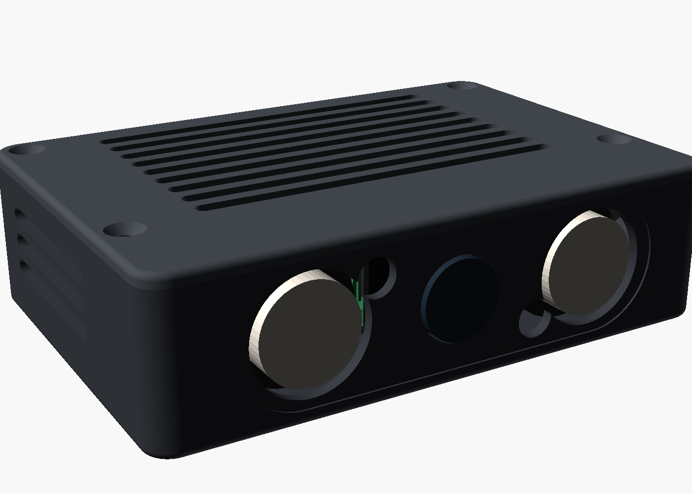
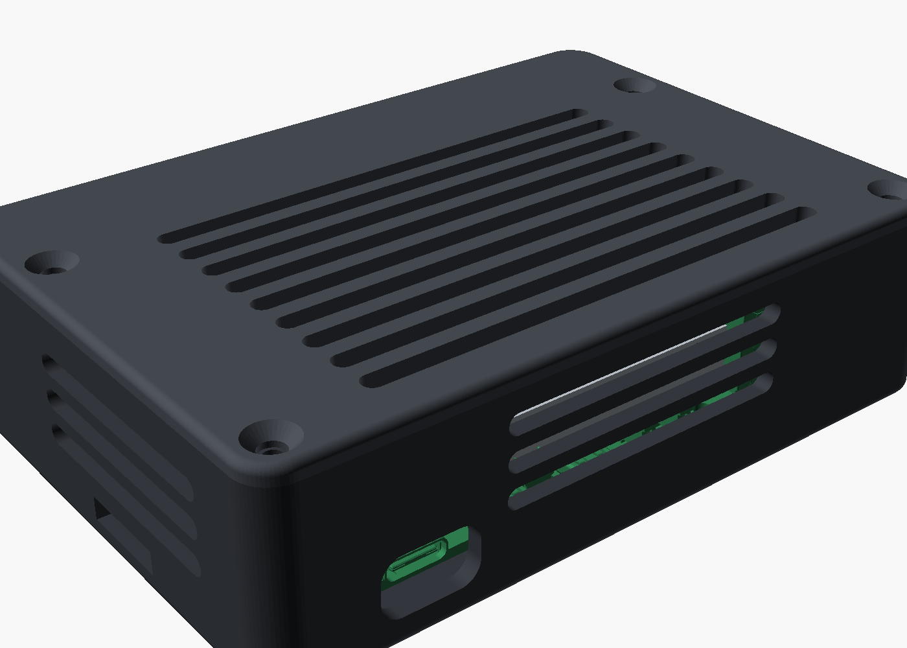
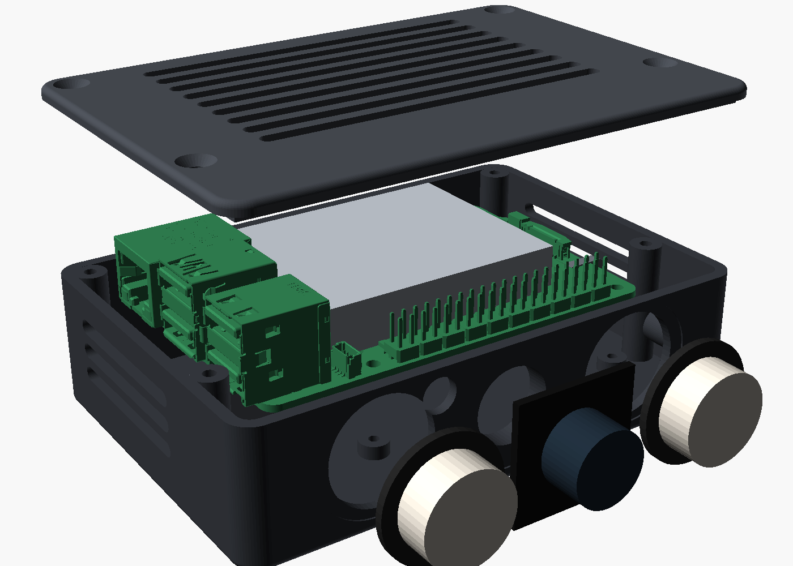

# Brick enclosure (concept B)

Pi 5 with the Active Cooler lying flat, the IR camera on the front wall. Openings are only for
**USB-C power** and **air**: fan grille on the lid, vents on the sides and back, plus a microSD slot.

**Outer size: 108.8 × 75 × 30 mm** (W × D × H).

| Front | Back | Inside |
|---|---|---|
|  |  |  |

## Files

- `brick.py`: the parametric CadQuery model. `python brick.py` writes `out/` (STEP + STL per part);
  `--pi-model` also extracts the Pi 5 board model that `render.scad` uses.
- `out/shell.*`, `out/lid.*`, `out/camera_clip.*`: STEP to edit in Fusion 360 / Onshape, STL to slice.
- `render.scad`: preview renders with the real Pi 5 model inside (OpenSCAD).

## Where the numbers come from

Measured from the reference models in `../ref/` (see `../ref/SOURCES.md`):

- **Pi 5:** board height and the 4 mounting holes match the OpenPiCase STEP model. The USB stack is
  16.2 mm tall and sticks out 0.9 mm further than the standard footprint says. The interior was
  widened for that. **A clash check against the real Pi model gives 0 mm³ overlap**, and the USB-C
  hole lines up with the model's port.
- **Camera:** taken from the night-vision camera mount made for this camera type: Ø15 lens, Ø21 IR
  openings at ±27.5 mm, the two light-sensor notches, and 7 mm from the inside of the front face to
  the back of the IR boards.

## How the camera is held

Like the original mount, the camera is **clamped, not screwed**. Two identical clips (print 2) press
on the back of the IR boards and push the camera against the front wall. Its screw-hole spacing
doesn't matter. **If it rattles, stick 1 mm foam tape on the clip pads.**

The light-sensor notches assume the camera is upright, with the left IR board's sensor at the top
(as in your photo). If the image comes out upside down, rotate it in software.

## Print

- **PETG or ASA**, not PLA (a parked car gets too hot for PLA). 0.2 mm layers, 4 walls, 20 % infill.
- Shell: open side up, no supports. Lid: outer face down. Clips: flat.

## Hardware

| Qty | Part | Use |
|---|---|---|
| 4 | M2.5 × 5 pan-head | Pi → standoffs (self-tapping, 2.1 mm pilots) |
| 2 | M2.5 × 6 pan-head | camera clips → front bosses |
| 4 | M3 × 10 countersunk | lid → corner posts (2.5 mm pilots) |

## Assembly

1. Put the camera into the front from inside, lens and IR lights through their holes.
2. Screw the two clips on over the IR boards.
3. Screw the Pi onto the standoffs (USB-C at the back) and connect the camera ribbon. The ribbon runs
   back over the board, under the lid.
4. Close the lid. Power goes in through the back.

## Not verified yet

- **Nothing printed yet.** The camera clamp depth comes from the mount model, not your board. The
  foam-tape note covers small differences.
- **The Active Cooler isn't in the reference model.** The lid sits 4.7 mm above the USB stack, the
  tallest part, so the cooler has room. The ribbon crosses part of the grille.
- **No mount yet**, since placement in the car comes later.
